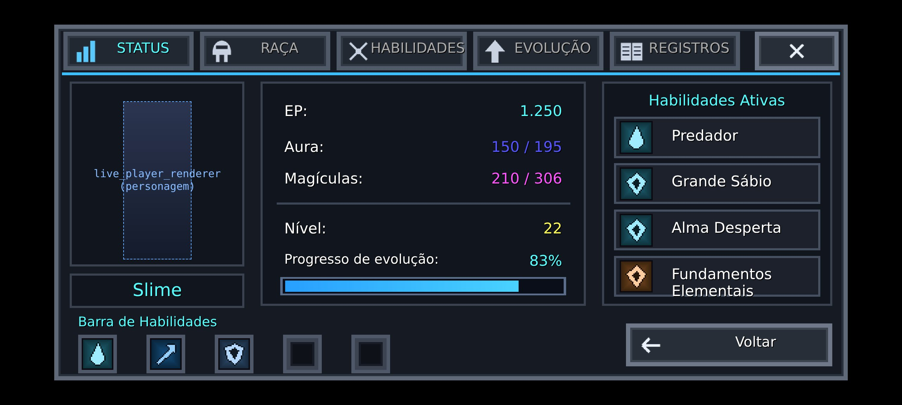
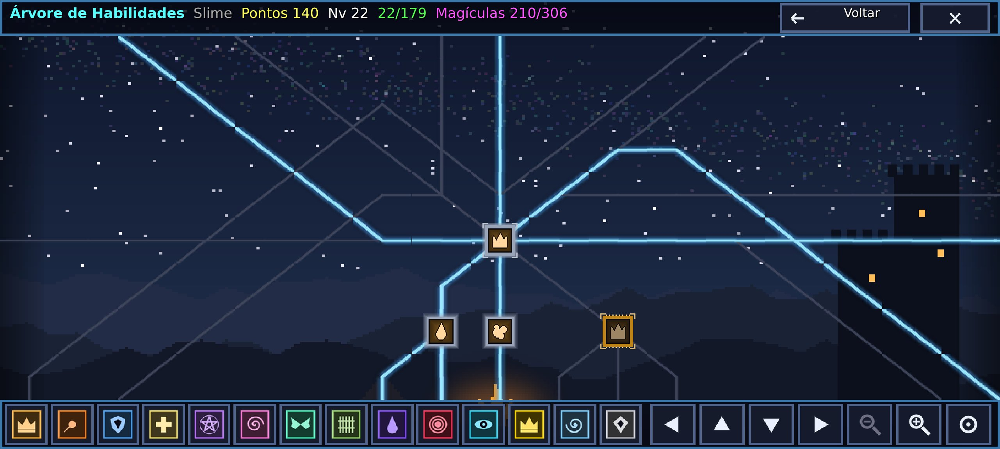
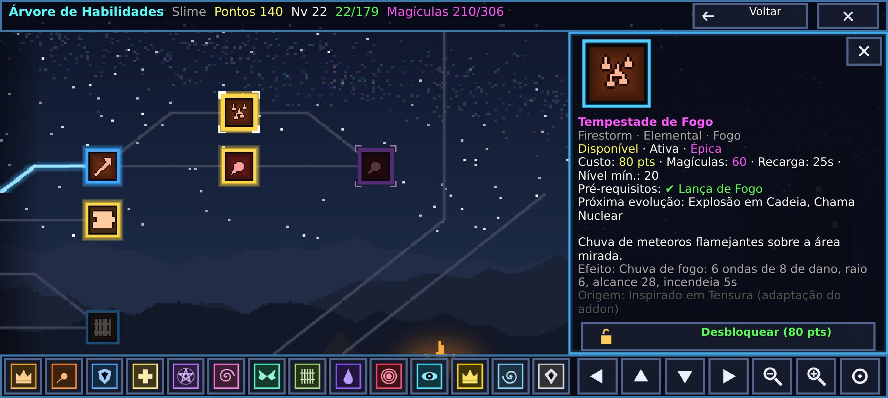
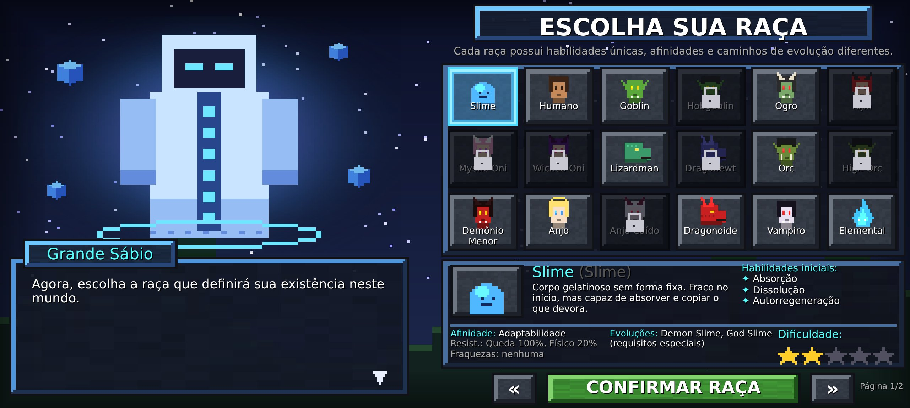

# Tensura RPG — addon para Minecraft Bedrock / PE

Sistema de RPG inspirado em *That Time I Got Reincarnated as a Slime* (Tensura):
raças com evoluções, magias universais e especiais, Magicules, progressão por EP
e uma **árvore de habilidades visual em tela cheia**.

> Projeto de fã, sem afiliação com a obra ou com a Mojang. Conteúdo original do addon
> é marcado como tal no jogo (painel de detalhes) e em [`docs/CATALOGO.md`](docs/CATALOGO.md).

| | |
|---|---|
| Minecraft | Bedrock / PE **1.21.90 ou superior** |
| Script API | `@minecraft/server` **2.0.0** e `@minecraft/server-ui` **2.0.0** (estáveis, sem experimentos) |
| Conteúdo | 50 raças em 19 linhagens, 333 habilidades em 14 categorias (incluindo Únicas, Supremas, Extras e Resistências do anime), 10 invocações |





*Capturas do simulador do JSON UI (`tools/preview.mjs`), que interpreta os arquivos gerados com as
texturas reais. Não são capturas do jogo — veja “O que foi e o que não foi testado”.*

## Instalação

**Pelo celular (GitHub Actions):** a cada alteração em `tensura-addon/`, o workflow
*Build Tensura RPG Addon* gera o pacote. Na aba **Actions**, abra a execução e baixe o
artefato `TensuraRPG-mcaddon`. Em execuções na `main` ou pelo botão *Run workflow*, ele também
publica uma Release com o `.mcaddon`. Abra o arquivo com o Minecraft, crie ou edite um mundo e
ative os dois pacotes (comportamento e recursos).

**No computador:** `cd tensura-addon && npm ci && npm run build` → `dist/TensuraRPG_v0.1.0.mcaddon`.

Não é preciso ativar experimentos.

## Primeira entrada: o Grande Sábio

Ao entrar num mundo pela primeira vez, o **Grande Sábio** surge diante do jogador:
- a tela tinge de azul/roxo, a câmera se aproxima dele e as falas aparecem letra a letra
  (agache para avançar);
- em seguida abre a tela **Escolha sua Raça**, com 26 cards (as 7 evoluções aparecem bloqueadas),
  painel de informações e o botão **CONFIRMAR RAÇA**.



## Como jogar (sem comandos)

1. Ao entrar no mundo você recebe dois itens (também fabricáveis na bancada):
   - **Grimório do Grande Sábio** — livro + lápis-lazúli + fragmento de ametista.
   - **Cristal de Magicules** — fragmento de ametista + lápis-lazúli + redstone.
2. **Use o Grimório** → na primeira vez, escolha a raça (permanente; você muda evoluindo).
   Depois ele abre o **menu principal** com as abas **Status** (personagem, EP, Aura, Magículas, nível,
   progresso de evolução, habilidades em destaque e a Barra de Habilidades de 5 espaços), **Raça**,
   **Habilidades** (abre a árvore), **Evolução** (requisitos e botão de evoluir) e **Registros**
   (conquistas, criaturas derrotadas, espécies absorvidas).
3. A **árvore de habilidades** é um **mapa único** em tela cheia: sua raça no centro e as 13 categorias
   em volta, com nós quadrados em pixel art e linhas retas e diagonais.
   - **Toque num nó** para ver os detalhes (nome em português e original, ícone, descrição,
     categoria, raridade, custo em pontos e Magicules, pré-requisitos, próxima evolução, efeito
     real e origem). Se tudo estiver atendido aparece **Desbloquear**; senão, a lista exata do que falta.
   - **Setas** movem a câmera nas 4 direções; **lupas** aproximam/afastam (3 níveis);
     **mira** centraliza na raiz.
   - **Ícones de categoria** na parte de baixo levam a câmera direto para Racial, Elemental, Aspectual,
     Sagrada, Invocação, Ilusão, Espiritual, Necromancia, Trevas, Avançada, Únicas, Supremas, Extras e
     Resistências. **Voltar** retorna ao menu.
   - Pré-requisitos de outra categoria aparecem como **nó compartilhado** (selo azul) ao lado de quem
     precisa dele; tocar nele leva ao original.
   - **Grimório** (topo) lista as magias aprendidas: conjurar, equipar no Cristal, ver na árvore.
   - **Status** mostra raça, nível, EP, Magicules, resistências, fraquezas e conquistas.
4. **Use o Cristal** para conjurar a habilidade do espaço atual da barra; **agachado + usar** troca de espaço.
   Magias gastam **Magículas**; habilidades raciais gastam **Aura**. As duas aparecem na action bar.
5. Derrote criaturas para ganhar **EP** → níveis → **20 pontos por nível**. Derrotar o Wither, o Ender
   Dragon e o Warden dá pontos extras e libera requisitos das magias supremas.

## Sistemas

- **Raças e evoluções** (`data/races.js`, `data/trees/racial.js`): cada raça tem Magicules, regeneração,
  resistências, fraquezas, afinidades (custo menor por árvore), multiplicadores de dano por elemento,
  efeitos permanentes e mecânicas próprias (vampiro queima ao sol; dríade regenera ao sol; merfolk lento
  fora d’água; ghoul faminto). Ao escolher uma raça, só a raiz e 1–2 habilidades iniciais são concedidas;
  o resto se desbloqueia na árvore. Evoluções são nós da árvore com nível, pontos e quantidade de
  habilidades da linhagem; algumas exigem conquistas. Escolhas exclusivas: Mystic Oni × Wicked Oni,
  Arcanjo × Anjo Caído, Caminho Arcano × Marcial.
- **Magias** (`data/trees/*.js` + `systems/effects.js`): todas têm efeito funcional — projéteis simulados,
  feixes, cones, áreas, chuvas (inclusive relâmpagos reais), paredes e prisões temporárias, campos
  persistentes, cura, drenagem, teleporte, dominação, marionetes, transformação, armazenamento
  espacial, portal, inversão dia/noite, encantar, criar materiais…
- **Invocações** (`BP/entities/`): 10 entidades próprias (cão, basilisco, demônio, elementais médio e
  superior, espírito, familiar, guerreiro e arqueiro mortos-vivos, cópia) com dono, duração e
  comportamento: seguem você, atacam seus alvos, o espírito cura, o familiar vigia, o basilisco
  petrifica, a Legião Imortal se reergue.
- **Magicules** (`systems/magicules.js`): capacidade cresce com nível, passivas e Absorção; regeneração
  reduzida logo após conjurar; magias avançadas custam muito mais.
- **Salvamento individual**: tudo fica em propriedades dinâmicas do próprio jogador (persistem no
  mundo). Desbloqueios, evoluções e níveis salvam na hora; o resto a cada 5 s.

## Como a árvore visual funciona no Bedrock

O Bedrock não tem uma API de “desenho livre” para interfaces. A árvore usa os recursos que o jogo oferece:

- O script abre um `ActionFormData` cujo título contém o marcador `§t§n§s`.
- `RP/ui/server_form.json` direciona esse formulário para `RP/ui/tensura_tree.json`. Formulários
  sem o marcador continuam idênticos aos do jogo.
- A tela é uma **grade de células com posição fixa** (`collection_index`, mesmo padrão dos arquivos do
  próprio jogo). Cada célula tem uma camada de linhas e uma de nó (e, nos zooms maiores, uma de nome).
- O script calcula, para a câmera atual, o código de cada célula. A textura do nó é escolhida pelo
  estado, raridade, nó principal, compartilhado e selecionado (160 molduras); a das linhas, pelos tocos
  norte/leste/sul/oeste e seu estado (255 peças).
- O layout é automático (`core/layout.js`): raiz no centro, ramos nas 4 direções e linhas roteadas a
  partir dos **pré-requisitos reais**. As linhas saem dos mesmos dados das posições, então sempre
  encostam nos nós.

**Adicionar uma habilidade** = acrescentar um `S(...)` num arquivo de árvore e rodar `npm run build`.
A interface não precisa ser refeita. O custo de desenho não depende do tamanho da árvore: só as
células visíveis são enviadas (no máximo 205 botões no zoom mais afastado).

## Estrutura

```
tensura-addon/
├── BP/                         Behavior Pack
│   ├── manifest.json
│   ├── items/ recipes/ entities/
│   └── scripts/
│       ├── main.js             eventos (itens, login, intervalos)
│       ├── config.js           balanceamento (custos por raridade, EP, Magicules, PvP...)
│       ├── data/               raças, elementos e as 28 árvores (dados puros)
│       ├── core/               lógica pura e testável: progressão, layout, atributos, interface, salvamento
│       ├── systems/            efeitos, projéteis, campos, invocações, passivas, combate, Magicules
│       └── ui/                 árvore (treeUI.js) e menus auxiliares
├── RP/                         Resource Pack (UI gerada, texturas geradas, clientes das invocações)
├── tools/                      build, gerador de UI, texturas, entidades, simulador e catálogo
├── test/                       testes automatizados (node --test)
└── docs/                       catálogo, relatório por fase e imagens
```

Comandos: `npm test`, `npm run typecheck`, `npm run build` (`-- --textures` regenera as texturas),
`node tools/preview.mjs saida.html <cenário>`, `node tools/ascii.mjs <árvore>`, `node tools/catalog.mjs`.

## Configuração

`BP/scripts/config.js`: faixas de custo por raridade (Comum 10–30, Rara 30–60, Épica 60–120,
Lendária 120–250, Suprema 250+) e `costMultiplier`; EP, pontos por nível, pontos iniciais e por chefe;
Magicules por nível; limites de desempenho (projéteis, invocações, blocos temporários); grades de zoom;
`pvp` (padrão: desligado) e `explosionsBreakBlocks` (padrão: não quebra blocos).

## Limitações conhecidas (do Bedrock e deste addon)

- **Arrastar com o dedo não existe em formulários do Bedrock.** A navegação usa setas (passo de ⅓ da
  tela), 3 níveis de zoom e centralizar. Cada toque reabre o formulário, então há uma breve transição.
- O roteador mantém o formulário padrão do jogo como alternativa invisível. O jogo ainda cria esses
  botões ocultos. É um custo extra de abertura que só um teste em aparelho fraco vai medir.
- **Voo** usa levitação/queda lenta (não é o voo do modo criativo).
- **Dominação** pacifica (sem força para atacar) e doma animais domesticáveis; não dá controle direto.
- As invocações reaproveitam modelos e texturas do próprio jogo (lobo, silverfish, vex, blaze, golem,
  allay, morcego, zumbi, esqueleto).
- A classificação “obra / adaptado / original” é a melhor estimativa e deve ser revisada.
